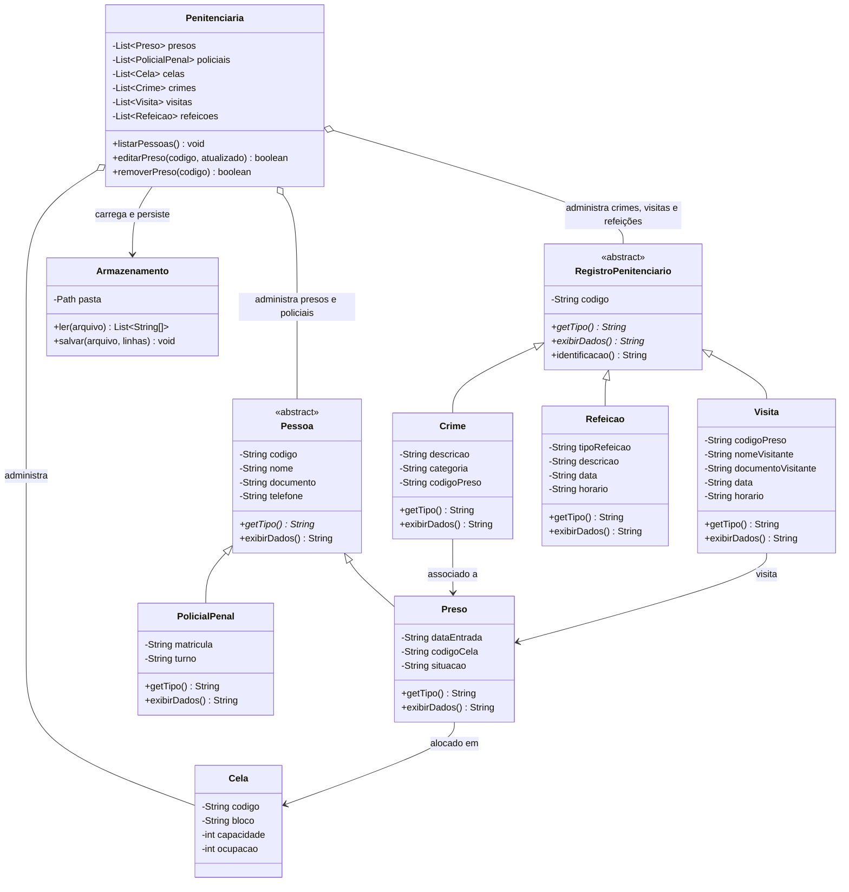

# Diagrama de classes

**Justificativa das mudanças em relação à implementação-base:** foi criada a
hierarquia abstrata `RegistroPenitenciario` para que Crime, Visita e Refeicao
formem a segunda hierarquia exigida nesta etapa; `Pessoa` continua sendo a
hierarquia de pessoas. O diagrama representa as classes e associações atuais.

O diagrama da Etapa 1 não estava disponível nos arquivos fornecidos; compare
este diagrama com o original da equipe antes da entrega final e inclua outras
alterações se o diagrama anterior tiver classes ou relacionamentos diferentes.
